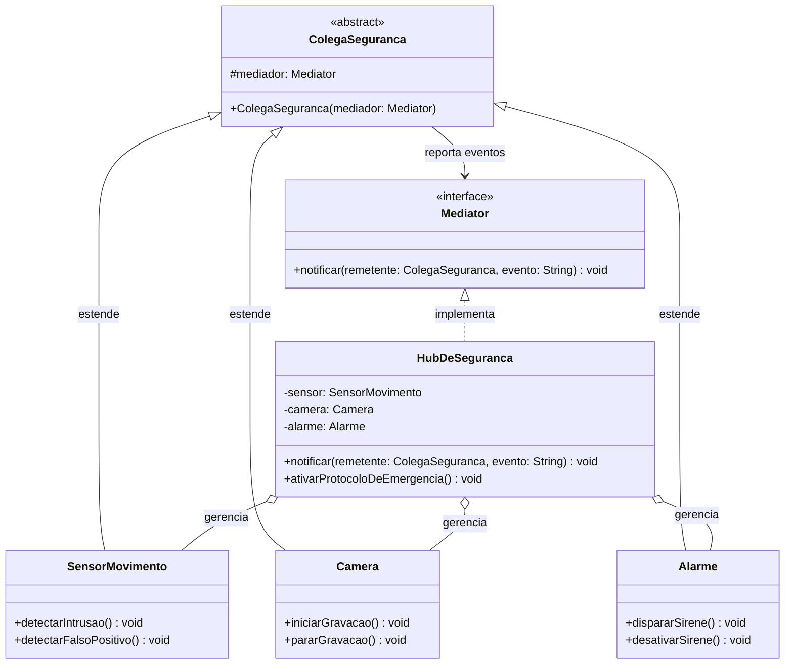

# Padrão Mediator - Hub de Coordenação de Sensores de Segurança

[](https://openjdk.java.net/)
[](https://junit.org/junit5/)

Implementação do padrão de projeto **Mediator** (Comportamental) em Java. O projeto demonstra como encapsular a forma como um conjunto de objetos interage, promovendo baixo acoplamento ao impedir que os objetos se refiram explicitamente uns aos outros.

---

## Descrição e Intenção

**Definição (GoF):** Definir um objeto que encapsula como um conjunto de objetos interage. O Mediator promove o acoplamento fraco ao evitar que os objetos se refiram explicitamente uns aos outros, permitindo que você varie suas interações independentemente.

### O Problema (A "Teia de Aranha")
Em um sistema de segurança física, dispositivos como Sensores de Movimento, Câmeras e Alarmes precisam cooperar. Se o Sensor detectar uma intrusão, ele deve acionar a Câmera e o Alarme. 
Se cada dispositivo se comunicar diretamente com os outros, cria-se um acoplamento many-to-many (teia de aranha). Adicionar um novo dispositivo (ex: `SensorDeFumaca`) exigiria modificar o código de **todos** os dispositivos existentes para que eles saibam como interagir com o novo componente, violando o Princípio Aberto/Fechado (OCP).

### A Solução
O padrão Mediator introduz um objeto central, o `HubDeSeguranca` (Mediador), que encapsula toda a lógica de interação. Os dispositivos (Colegas) não se conhecem; eles apenas reportam eventos ao Mediador. Cabe ao Mediador decidir quem deve ser notificado e em que ordem.

---

## Estrutura do Projeto

```bash
src/
├── main/
│   └── padroescomportamentais/mediator/
│       ├── Mediator.java                (Interface do Mediador)
│       ├── HubDeSeguranca.java          (Mediador Concreto)
│       ├── ColegaSeguranca.java         (Classe Abstrata do Colega)
│       ├── SensorMovimento.java         (Colega Concreto A)
│       ├── Camera.java                  (Colega Concreto B)
│       └── Alarme.java                  (Colega Concreto C)
│
└── test/
    └── padroescomportamentais/mediator/
        └── HubDeSegurancaTest.java      (Casos de teste)
```

## Diagrama de Classes
O diagrama abaixo ilustra a topologia em "estrela", onde todas as comunicações passam pelo Mediador central, eliminando as dependências diretas entre os colegas.



### Análise Crítica: Vantagens e Pontos Cegos

É fundamental diferenciar os benefícios teóricos dos riscos práticos de implementação.

#### Vantagens (Fatos)
* **Princípio da Responsabilidade Única (SRP):** A lógica complexa de interação entre os componentes é extraída dos colegas e centralizada em uma única classe (o Mediador).
* **Princípio Aberto/Fechado (OCP):** É possível introduzir novos colegas (ex: `SensorDeFumaca`) sem modificar as classes dos colegas existentes. Apenas o Mediador precisa ser atualizado para lidar com o novo evento.
* **Desacoplamento:** Os colegas não dependem uns dos outros. Eles podem ser reutilizados em outros contextos mais facilmente.

#### Pontos Cegos e Contrapontos (Onde o padrão exige cuidado)
1. **O Problema do "Objeto Deus" (God Object):**
   * **Fato:** Ao centralizar toda a lógica de comunicação, o Mediador tende a crescer descontroladamente, acumulando muitas responsabilidades condicionais (`if/else` ou `switch` baseados no evento).
   * **Contraponto:** Se o sistema for muito complexo, o `HubDeSeguranca` pode se tornar uma classe gigante e difícil de manter.
   * **Solução:** Quebrar o Mediador em múltiplos mediadores menores (por domínio) ou usar o padrão **Observer** internamente dentro do Mediador para distribuir as notificações de forma mais limpa.
2. **Lógica de Interação Oculta:**
   * **Fato:** Ao olhar apenas para a classe `SensorMovimento`, é impossível saber o que acontece quando ele detecta uma intrusão.
   * **Contraponto:** A lógica está "escondida" dentro do Mediador. Isso pode dificultar o *debugging* e o rastreamento do fluxo de execução para desenvolvedores novos no projeto, exigindo logs robustos.

---

### Diferença Crucial: Mediator vs. Observer

Esta é a confusão mais comum em provas e revisões de código, pois ambos lidam com comunicação indireta entre objetos.

| Característica | Padrão Mediator | Padrão Observer |
| :--- | :--- | :--- |
| **Topologia** | **Estrela** (Todos falam com o centro, o centro coordena). | **Pub/Sub** (Um fala para muitos). |
| **Direção da Comunicação** | **Multi-direcional** (Os colegas enviam e recebem via Mediador). | **Unidirecional** (Sujeito → Observadores). |
| **Intenção** | Gerenciar interações complexas e regras de negócio entre colegas que não se conhecem. | Notificar interessados sobre mudanças de estado de um objeto. |
| **Exemplo** | O Hub decide que Sensor → liga Câmera → dispara Alarme. | A Central de Ameaças avisa todos os Analistas inscritos. |

> **Nota:** Conforme o catálogo GoF (Capítulo 11.6 da apostila), o padrão Mediator é frequentemente implementado usando o padrão Observer. O Mediador atua como o "Sujeito" e os Colegas atuam como "Observadores" para receber as ordens de volta.

---

### Testes

O projeto contém testes unitários (JUnit 5) que validam:
* O `SensorMovimento` não conhece a `Camera` nem o `Alarme` (baixo acoplamento comprovado via Reflection).
* Ao detectar uma intrusão, o Mediador orquestra a ativação da Câmera e do Alarme na ordem correta.
* A adição de um novo colega não quebra a comunicação dos colegas existentes.

---

### Tecnologias Utilizadas

| Tecnologia | Versão | Finalidade no Projeto |
| :--- | :--- | :--- |
| **Java** | 21 | Linguagem de programação principal |
| **Maven** | 3.9+ | Gerenciamento de dependências e automação de build |
| **JUnit 5** | 5.9.x | Framework para execução dos testes unitários |
| **Draw.io / Mermaid** | Web | Criação e renderização dos diagramas UML |
